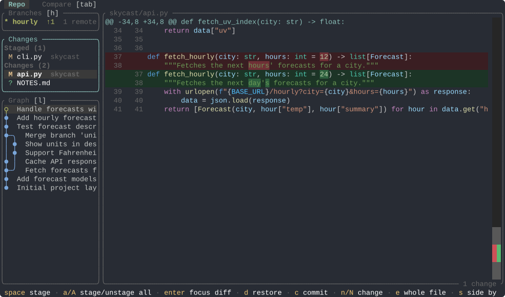
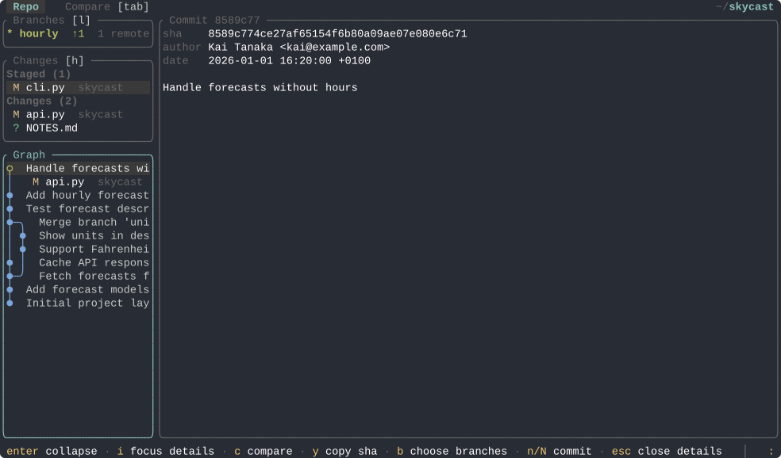
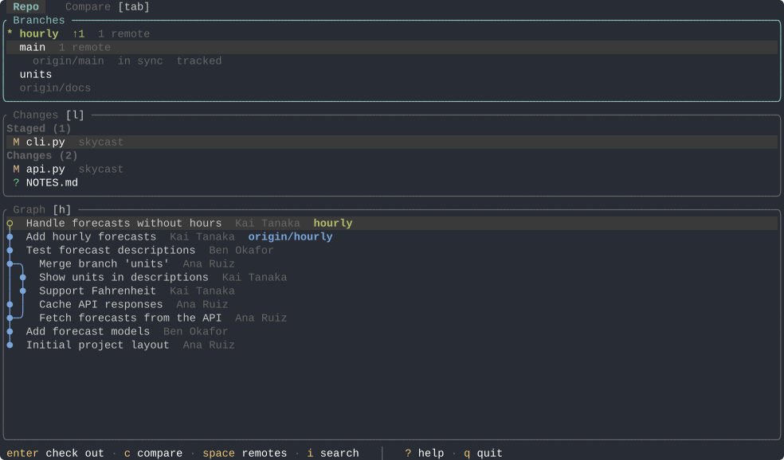
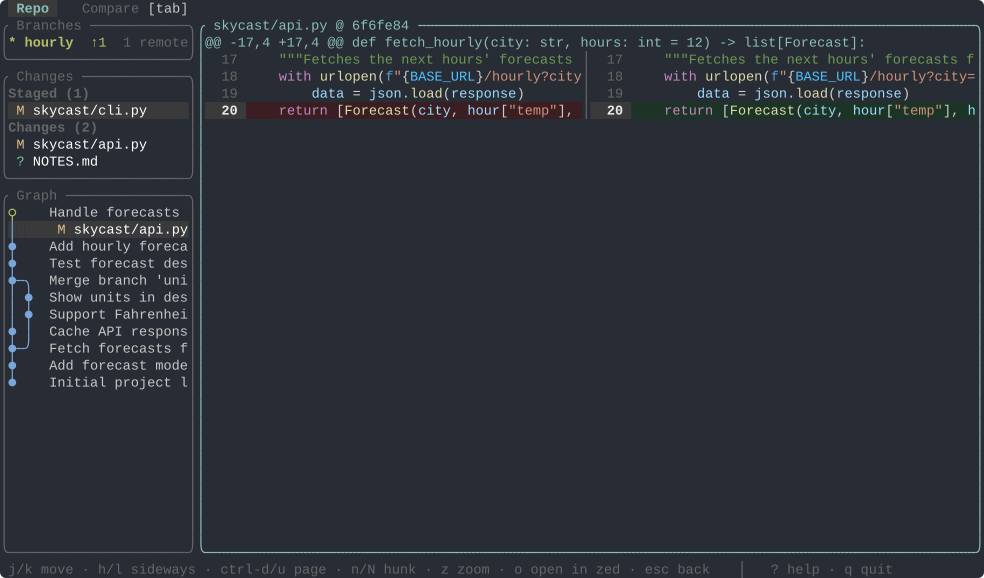
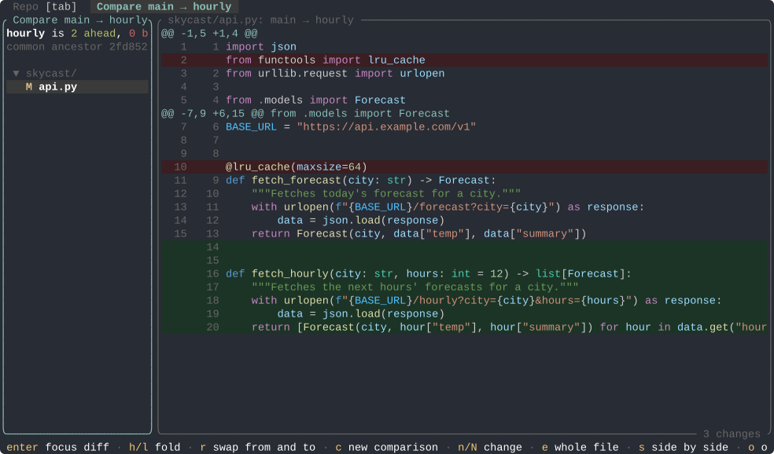
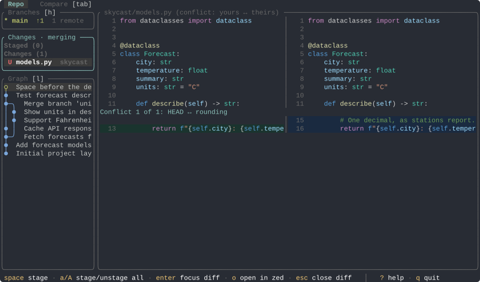
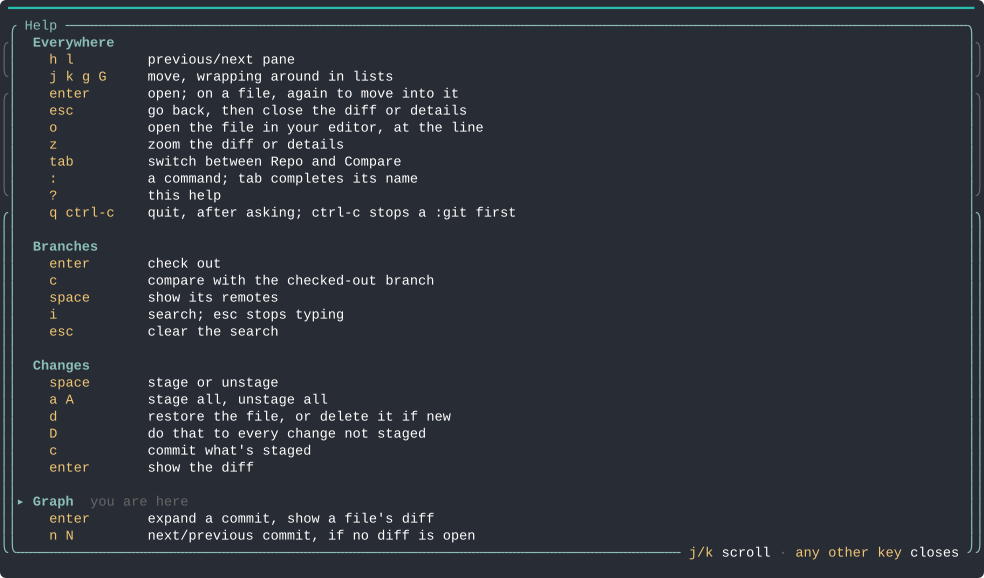

# gclic (git CLI companion)

**gclic**, pronounced *g-click*, is a TUI intended to complement git's CLI for operations that are best done visually.

If you are looking for a mature and feature complete git TUI check out [lazygit](https://github.com/jesseduffield/lazygit).
gclic is heavily inspired by the features I like and have grown accustomed to in [VS Code's git client](https://code.visualstudio.com/docs/sourcecontrol/overview) and the [GitLens](https://marketplace.visualstudio.com/items?itemName=eamodio.GitLens) extension and that I miss in [Zed](https://zed.dev). gclic intentionally leaves out operations that in my opinion gain little from being visual, such as pushing, pulling and fetching, merging and rebasing, or creating branches, which it leaves to git's CLI, or to running git from gclic itself. The one exception is a fetch in the background, so what it shows of the remotes stays current. Others, like resolving conflicts, certainly benefit from being visual, but belong in a full-fledged editor, which gclic does not aspire to be: it shows the conflict, and opens it in your editor.

## Features

- **[Staging and commit](#staging-and-commit):** browse changed files, stage, unstage or restore them, and commit.
- **[Branch graph](#branch-graph):** navigate a commit graph of any set of branches, open a commit's files and diffs, read its details and copy its sha.
- **[Branches](#branches):** fuzzy search and check out branches, and see how far each one is ahead of or behind its remotes.
- **[Diffs](#diffs):** read any file's changes side by side or unified, with syntax highlighting, the changed words marked, and a minimap of the whole file.
- **[Compare](#compare):** pick any two refs to see how far they have diverged and which files differ.
- **[Merge conflicts](#merge-conflicts):** see each conflict as your side against theirs, and open it in your editor to resolve it.
- **[Stashes](#stashes):** see what's in each stash, and apply, pop or drop it.
- **[Running commands](#running-commands):** run git, or anything else, from gclic, in the repo it shows.
- **[Switching repos](#switching-repos):** fuzzy find any repo near the one you're in, and switch to it without leaving gclic.
- **[Keyboard driven](#keyboard-driven):** with Vim-style keybindings, and the keys that apply always shown at the bottom.

## Installation

**On Windows**, download `gclic-v<version>-windows-x86_64.zip` from the [releases](https://github.com/chuan97/gclic/releases) and extract `gclic.exe`. To run it from any folder, put it in a folder on your `PATH`, for example a `bin` folder in your user folder:

1. Create the folder `C:\Users\<you>\bin` and move `gclic.exe` into it.
2. Open the Start menu, search for *Edit environment variables for your account*, and open it.
3. Under *User variables*, select `Path`, choose *Edit*, then *New*, and enter `%USERPROFILE%\bin`.
4. Choose *OK* in both windows, and open a new terminal.

gclic isn't signed yet, so the first time Windows may say it "protected your PC": choose *More info*, then *Run anyway*. It needs [Git for Windows](https://git-scm.com/download/win), and looks best in [Windows Terminal](https://aka.ms/terminal).

**From source**, on any platform with [Rust](https://rustup.rs) installed:

```sh
cargo install --git https://github.com/chuan97/gclic
```

Then run `gclic` inside a git repository. Press `?` for help.

**Note:** As of now, gclic is fully *vibe-coded*. It is barely a working prototype, and has only been tested in macOS with [Ghostty](https://ghostty.org) as the terminal emulator. It is best run in a horizontally split pane, with gclic in one pane and git's CLI in the other.

gclic currently expects:
- **git** on the `PATH`.
- **[Zed](https://zed.dev)**, to open files in an editor with `o`.

In [Ghostty](https://ghostty.org) and [kitty](https://sw.kovidgoyal.net/kitty/), which draw git graph symbols themselves, the graph's beads join up with their lines, as in the screenshots. Other terminals, including Windows Terminal, get plain beads, and look the same otherwise.

## Staging and commit

The Changes pane lists staged and unstaged files, each name followed by its folder. `space` stages or unstages one, `a`/`A` all of them, `d` restores a file (after asking), `D` every file not staged, and `c` commits what's staged, with `ctrl-enter` to confirm. `enter` shows a file's diff on the right, and the diff follows as you move through the list.



## Branch graph

The graph shows the checked-out branch and its upstream by default, or any branches you pick with `b`. Commits not yet pushed are hollow. `enter` opens a commit's files, `i` shows its details on the right, `y` copies its sha, and `n`/`N` jump between commits.



## Branches

The Branches pane shows the checked-out branch, and when focused, every branch. Each one shows how far it is ahead (↑) or behind (↓) its upstream. To keep that current, gclic fetches the remotes your branches track every minute, in the background, and its title says how long ago it last did. It never asks for a password or passphrase, so it works where you've already signed in, as with an SSH agent or stored credentials, and says `fetch failed` otherwise. `:fetch` fetches now, and `:fetch off` stops it for the session. `enter` checks a branch out, `i` searches, `space` lists a branch's remotes, and `c` compares it with the checked-out branch.



## Diffs

Diffs are syntax highlighted with VS Code's Dark Modern colours, with the words that changed marked. They're side by side when the pane is wide enough for about 80 columns of text a side, and unified otherwise. A minimap down the right edge shows the whole file, its removed lines on the left and its added ones on the right, with the part on screen lighter. The bottom border counts the changes, and says which one you're on.

From any pane, while a diff is showing, `n`/`N` jump between its changes, `e` switches between the whole file and just the changes, and `s` between side by side and unified. A second `enter` moves into a diff: `j`/`k` move the active line, `h`/`l` scroll sideways, and `o` opens the file in Zed at the active line.



## Compare

The Compare tab, reached with `tab`, shows how two refs differ, going *from* one *to* the other, a trip through the commit graph rather than an order in time: how far the to is ahead of and behind the from, their common ancestor, and the files that differ, in a tree of their folders, each with its diff. `c` starts a comparison, from the Branches pane, the graph, or the tab itself, and `r` swaps from and to.



## Merge conflicts

While a merge, rebase or cherry-pick is stopped on conflicts, the Changes pane says so, and lists the conflicted files in a section of their own, above the staged ones. A conflicted file's preview shows each conflict as your side (green) against theirs (blue). Resolve them in your editor with `o`, which opens the file at the conflict, then mark the file resolved with `space`, which stages it.



## Stashes

`:stash` lists your stashes. `enter` shows a stash's files, untracked ones included, each with its diff, as a comparison does. `a` applies it, with every change back unstaged, `p` pops it, and `d` drops it after asking. The graph shows each stash too, hanging off the commit it was made on, with the same keys. Making one is left to `:git stash`, which has the options for what goes in it.

## Running commands

`:git …` runs a git command in the background, in the repo gclic shows, which refreshes once it ends. A line of output goes to the message line, and more to a popup, red if it failed. `ctrl-c` stops it. It has no terminal to ask anything on, so a command that would open an editor or ask for a password fails at once, and says to run it with `:!` instead. Keys in an SSH agent still work. When a command fails and git suggests one to run instead, such as `git push --set-upstream origin main`, the next `:` offers it, and `tab` fills it in.

`:!…` runs any command in your shell, with the terminal to itself, gclic stepping aside meanwhile: an editor, `git add -p`, `git rebase -i`, or `gclic` itself. If it printed something, gclic waits for enter so you can read it, and otherwise, as when quitting vim, comes straight back.

## Switching repos

`:` opens a command line at the bottom, for things done now and then rather than all the time. `:cd` lists the git repos in the folder holding the current one, to fuzzy find one and switch to it, with `..` first to search a folder up. `:cd name` switches straight to the repo `name` can only mean, its folder's name or the only one it matches, and otherwise starts the search with `name` typed in. `:cd ..` searches a folder up. Started outside a repo, say in `~/Code`, gclic lists the repos under it to open one, and `:cd` keeps searching there.

## Keyboard driven

Every action has a key, mostly Vim-style. `h`/`l` move between panes, marked `[h]` and `[l]` on their borders. The bar at the bottom lists the keys that apply right now, and `?` shows them all.



---

The screenshots are made from gclic itself, by `docs/screenshots.py`, on a demo repo it builds.

## License

gclic is under the [MIT License](LICENSE). Its colours are those of VS Code's Dark Modern theme, from [VS Code](https://github.com/microsoft/vscode), Copyright (c) Microsoft Corporation, also under the MIT License.
