# gclic (git CLI companion)

**gclic**, pronounced *g-click*, is a TUI that complements git's CLI for operations that are best done visually, and embeds a command line to run git's CLI itself for the rest.

If you are looking for a mature and feature complete git TUI check out [lazygit](https://github.com/jesseduffield/lazygit).
gclic is heavily inspired by the features I like and have grown accustomed to in [VS Code's git client](https://code.visualstudio.com/docs/sourcecontrol/overview) and the [GitLens](https://marketplace.visualstudio.com/items?itemName=eamodio.GitLens) extension and that I miss in other editors. gclic intentionally relies on git's CLI for operations that, in my opinion, gain little from being visual, such as pushing, pulling, merging, rebasing or creating branches. Type `:git push`, or any other git command, on its built-in command line, and gclic runs it in the repo you have open. For commands that need the terminal, like interactive ones such as `git rebase -i`, `:!` sets gclic aside and runs them in your shell. Other operations, like resolving conflicts, certainly benefit from being visual, but belong in a full-fledged editor, which gclic does not aspire to be: it shows the conflict, and opens it in your editor.

## Features

- **[Staging and commit](#staging-and-commit):** browse changed files, stage, unstage or restore them, or one change of them at a time, and commit.
- **[Branch graph](#branch-graph):** navigate a commit graph of any set of branches, open a commit's files and diffs, read its details and copy its sha.
- **[Branches](#branches):** fuzzy search and check out branches, and see how far each one is ahead of or behind its remotes.
- **[Diffs](#diffs):** read any file's changes side by side or unified, with syntax highlighting, the changed words marked, and a minimap of the whole file.
- **[Compare](#compare):** pick any two refs to see how far they have diverged and which files differ.
- **[Merge conflicts](#merge-conflicts):** see each conflict as your side against theirs, and open it in your editor to resolve it.
- **[Stashes](#stashes):** see what's in each stash, and apply, pop or drop it.
- **[Review comments](#review-comments):** comment on the lines of any diff, and copy the comments as one review, to paste to whoever made the changes.
- **[Running commands](#running-commands):** run git, or anything else, from gclic, in the repo it shows.
- **[Switching repos](#switching-repos):** fuzzy find any repo near the one you're in, and switch to it without leaving gclic.
- **[Your editor](#your-editor):** open the file you're on in your editor, at the line.
- **[In Neovim](#in-neovim):** gclic in a sidebar beside the code, showing changes as files are saved, and over the whole editor for diffs; open files from it in the editor, and switch repos together.
- **[Keyboard driven](#keyboard-driven):** with Vim-style keybindings, and the keys that apply always shown at the bottom.

## Installation

**On macOS and Linux**, with [Homebrew](https://brew.sh):

```sh
brew install chuan97/tap/gclic
```

**On Windows**, with [Scoop](https://scoop.sh):

```powershell
scoop bucket add chuan97 https://github.com/chuan97/scoop-bucket
scoop install gclic
```

Without either, an installer puts the latest release in `~/.local/bin` and adds it to your `PATH`. On macOS and Linux:

```sh
curl -LsSf https://github.com/chuan97/gclic/releases/latest/download/gclic-installer.sh | sh
```

And on Windows, in PowerShell:

```powershell
powershell -ExecutionPolicy Bypass -c "irm https://github.com/chuan97/gclic/releases/latest/download/gclic-installer.ps1 | iex"
```

Each release also has the builds themselves, for macOS, Linux and Windows, on its [page](https://github.com/chuan97/gclic/releases).

gclic isn't signed, so the first time Windows may say it "protected your PC": choose *More info*, then *Run anyway*. It needs [Git for Windows](https://git-scm.com/download/win), and looks best in [Windows Terminal](https://aka.ms/terminal).

**From source**, on any platform with [Rust](https://rustup.rs) installed:

```sh
cargo install --git https://github.com/chuan97/gclic
```

**In Neovim**, the plugin installs gclic itself: see [In Neovim](#in-neovim).

Then run `gclic` inside a git repository. Press `?` for help.

gclic currently expects **git** on the `PATH`.

In [Ghostty](https://ghostty.org), [kitty](https://sw.kovidgoyal.net/kitty/) and [Rex](https://www.superlogical.com/rex), which draw git graph symbols themselves, the graph's beads join up with their lines, as in the screenshots. Other terminals, including Windows Terminal, get plain beads, and look the same otherwise. Set `GCLIC_BRANCH_SYMBOLS=1` to use the joined beads in another terminal that draws them, or `GCLIC_BRANCH_SYMBOLS=0` to always use plain beads.

## Staging and commit

The Changes pane lists staged and unstaged files, each name followed by its folder. `space` stages or unstages one, `a`/`A` all of them, `d` restores a file (after asking), `D` every file not staged, and `c` commits what's staged, with `ctrl-enter` to confirm. `enter` shows a file's diff on the right, and the diff follows as you move through the list.

Inside a file's diff, the same keys take one change at a time, the run of changed lines the active line is in, which `n`/`N` move between: `space` stages it from the file's unstaged diff, or unstages it from its staged diff, and `d` discards it from the unstaged diff, after asking. The rest of the file stays as it is.

In the Changes pane and inside a file's diff, `u` undoes the last staging, unstaging or discard, of a file or a change, and `ctrl-r` redoes it, as many steps back as you like while gclic runs. An undo that would lose an edit made since is refused. Deleting an untracked file can't be undone, as git never had it, and committing starts afresh.

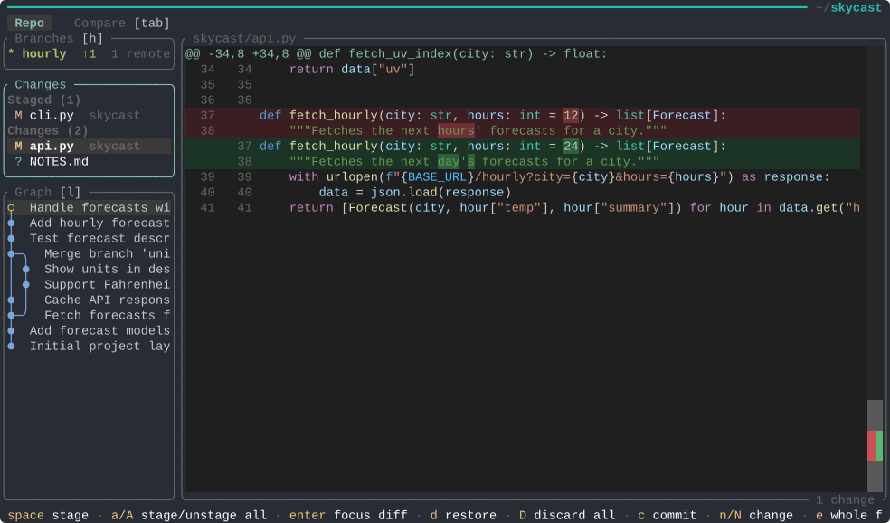

## Branch graph

The graph shows the checked-out branch and its upstream by default, or any branches you pick with `b`. Commits not yet pushed are hollow. `enter` opens a commit's files, with the lines each adds and removes, and the commit's total after its message, `i` shows its details on the right, `y` copies its sha, and `n`/`N` jump between commits.

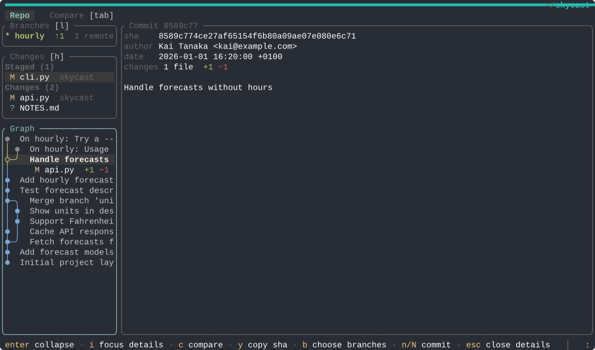

## Branches

The Branches pane shows the checked-out branch, and when focused, every branch. Each one shows how far it is ahead (↑) or behind (↓) its upstream. To keep that current, gclic fetches the remotes your branches track every minute, in the background, and its title says how long ago it last did. It never asks for a password or passphrase, so it works where you've already signed in, as with an SSH agent or stored credentials, and says `fetch failed` otherwise. `:fetch` fetches now, and `:fetch off` stops it for the session. `enter` checks a branch out, `i` searches, and searching a commit's sha lists the branches that have it, `space` lists a branch's remotes, and `c` compares it with the checked-out branch.

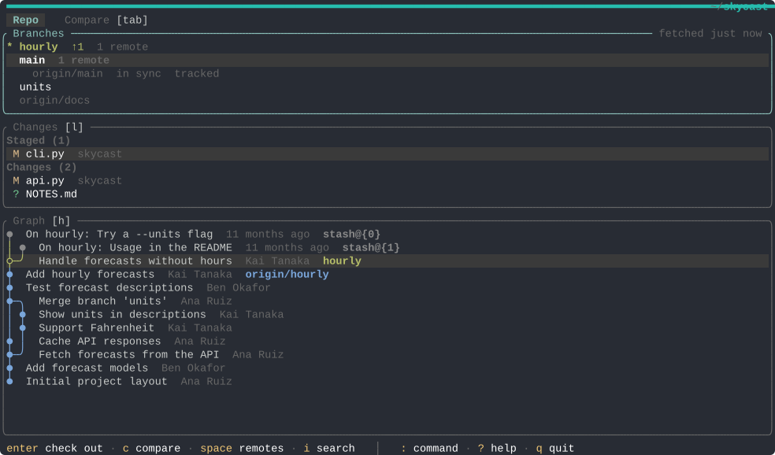

## Diffs

Diffs are syntax highlighted with VS Code's Dark Modern colours, with the words that changed marked. They're side by side when the pane is wide enough for about 80 columns of text a side, and unified otherwise. A minimap down the right edge shows the whole file, its removed lines on the left and its added ones on the right, with the part on screen lighter. The bottom border counts the changes, and says which one you're on.

From any pane, while a diff is showing, `n`/`N` jump between its changes, `e` switches between the whole file and just the changes, and `s` between side by side and unified. A second `enter` moves into a diff: `j`/`k` move the active line, `h`/`l` scroll sideways, and `o` opens the file in [your editor](#your-editor) at the active line.

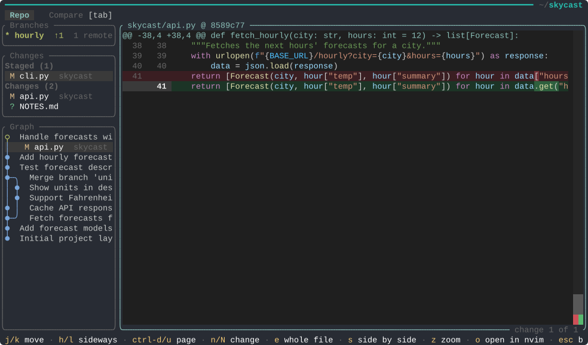

## Compare

The Compare tab, reached with `tab`, shows how two refs differ, going *from* one *to* the other, a trip through the commit graph rather than an order in time: how far the to is ahead of and behind the from, their common ancestor, and the files that differ, in a tree of their folders, each with its diff and the lines it adds and removes. `c` starts a comparison, from the Branches pane, the graph, or the tab itself, and `r` swaps from and to.

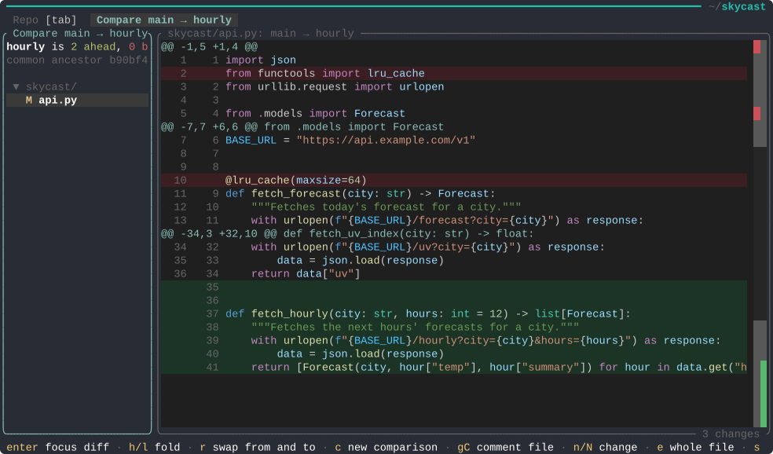

## Merge conflicts

While a merge, rebase or cherry-pick is stopped on conflicts, the Changes pane says so, and lists the conflicted files in a section of their own, above the staged ones. A conflicted file's preview shows each conflict as your side (green) against theirs (blue). In a rebase, which replays your commits onto upstream, it's the other way round, and the preview says so: upstream is green, and your commit, the one being replayed, blue. Resolve them in your editor with `o`, which opens the file at the conflict, then mark the file resolved with `space`, which stages it.

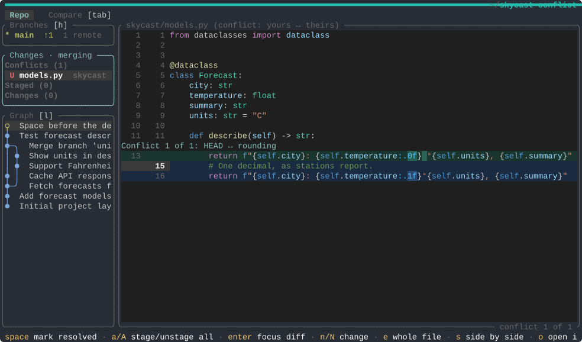

## Stashes

`:stash` lists your stashes. `enter` shows a stash's files, untracked ones included, each with its diff, as a comparison does. `a` applies it, with every change back unstaged, `p` pops it, and `d` drops it after asking. The graph shows each stash too, hanging off the commit it was made on, with the same keys. Making one is left to `:git stash`, which has the options for what goes in it.

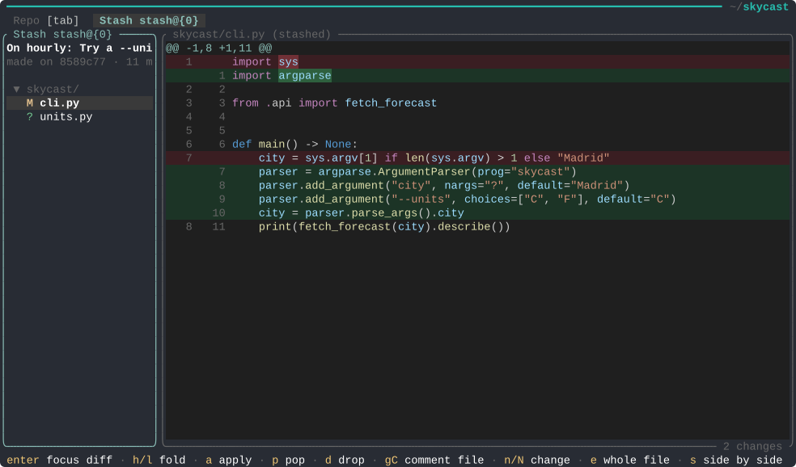

## Review comments

`gc` writes a comment on the diff's active line: in the Changes pane, a commit's files, a comparison or a stash. That works from inside the diff, or from the list beside it once `n` has stepped to a change, so a change can be commented on without entering the diff. `gC` writes a comment on the whole file the diff shows. A comment shows under its line, which gets a mark beside its number, or at the top of the diff for the whole file, and `gc` or `gC` there again edits it. A removed line takes comments too, as in "why did this go?". Saving a comment left empty removes it.

The first comment adds a Review tab, which `tab` goes to. It lists the comments under where they were made: uncommitted changes, which keep their comments when staged, a commit, or a comparison. Moving through them shows each one's diff at its line. `y` copies them all as one review to paste to whoever made the changes, each with its file, line number and the line itself, so the line can be found even after code has moved around. `c` edits a comment, `d` deletes one and `D` clears the review, each after asking. The Review tab goes once the last comment does.

Comments last until cleared, or until gclic quits, which says how many would be lost.

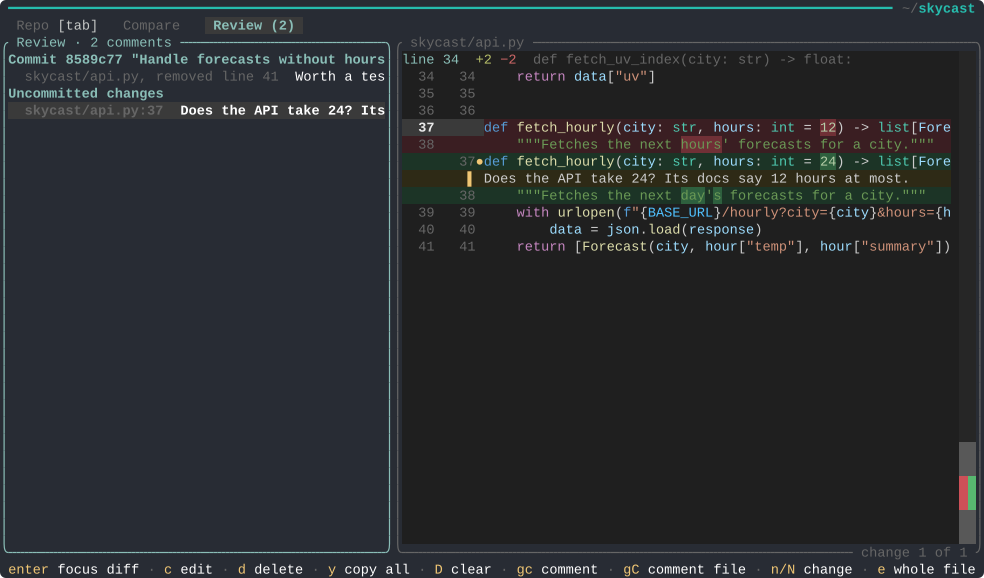

## Running commands

`:git …` runs a git command in the background, in the repo gclic shows, which refreshes once it ends. A line of output goes to the message line, and more to a popup, red if it failed. `ctrl-c` stops it. It has no terminal to ask anything on, so a command that would open an editor or ask for a password fails at once, and says to run it with `:!` instead. Keys in an SSH agent still work. When a command fails and git suggests one to run instead, such as `git push --set-upstream origin main`, the next `:` offers it, and `tab` fills it in.

`:!…` runs any command in your shell, with the terminal to itself, gclic stepping aside meanwhile: an editor, `git add -p`, `git rebase -i`, or `gclic` itself. If it printed something, gclic waits for enter so you can read it, and otherwise, as when quitting vim, comes straight back.

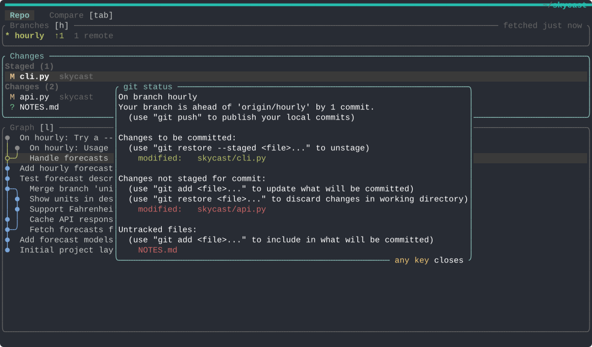

## Switching repos

`:` opens a command line at the bottom, for things done now and then rather than all the time. `:cd` lists the git repos in the folder holding the current one, to fuzzy find one and switch to it, with `..` first to search a folder up. `:cd name` switches straight to the repo `name` can only mean, its folder's name or the only one it matches, and otherwise starts the search with `name` typed in. `:cd ..` searches a folder up. Started outside a repo, say in `~/Code`, gclic lists the repos under it to open one, and `:cd` keeps searching there.

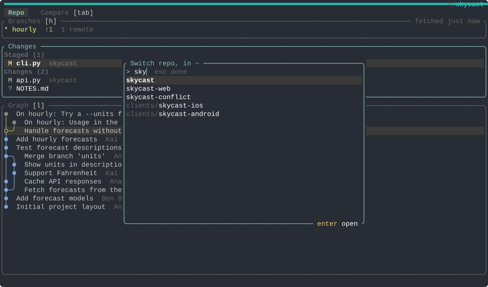

## Your editor

`o` opens the file you're on in your editor, at the line you're on in its diff. The editor is the first of `$GCLIC_EDITOR`, `$VISUAL` and `$EDITOR` that's set, as git picks its own: vi if none is, Notepad on Windows. A terminal editor, such as vim, Neovim or Helix, gets the terminal, and quitting it brings you back to gclic as you left it. A GUI one, such as Zed or VS Code, opens in its own window. gclic knows how the common editors take a line. For another, say where the file and line go: `GCLIC_EDITOR="myeditor --line {line} {file}"`.

To set it, add `export GCLIC_EDITOR=nvim` to your `~/.zshrc` or `~/.bashrc`, or on Windows run `[Environment]::SetEnvironmentVariable("GCLIC_EDITOR", "nvim", "User")` in PowerShell, and open a new terminal. The hint bar names the editor `o` will use.

## In Neovim

gclic comes with a Neovim plugin, for Neovim 0.10 or later, that shows gclic in a sidebar at the left, beside the code: the Repo tab's Branches, Changes and Graph, with the Changes pane showing a file as soon as it's saved. Everything works there, staging, discarding, undo and committing included. `enter` on a file shows its diff over the whole editor, and `i` on a commit its details, which say how many files and lines it changes; closing them goes back to the sidebar. The Compare and Review tabs show over the whole editor too. `z` only changes the size: from the sidebar it goes over the whole editor, where gclic's panes take the whole width, or the sidebar's beside a diff, so they stay put as it opens; there, `z` zooms a diff and comes back out, and with nothing open goes back to the sidebar. After `z`, gclic stays over the whole editor as diffs close, until `z` or `ctrl-g` goes back. gclic keeps running while hidden, so it's as you left it each time it comes back. `o` opens the file in the editor beside the sidebar, at the line. `:cd` in gclic changes Neovim's working folder, and `:cd` in Neovim moves gclic to that repo. A bar across the top shows the repo in gclic's colour for it, and gclic takes the colour scheme's colours, its diffs included.

The plugin installs the gclic release matching its version, into Neovim's data folder, and runs it, so there's nothing else to install. With [lazy.nvim](https://github.com/folke/lazy.nvim), which does it on installing and updating the plugin:

```lua
{
  "chuan97/gclic",
  -- Releases only, to match a released gclic.
  version = "*",
  -- At startup, for the bar across the top.
  event = "VeryLazy",
  cmd = "Gclic",
  keys = { { "<leader>gg", function() require("gclic").toggle() end, desc = "gclic" } },
  opts = {},
}
```

With another plugin manager, install the repo, call `require("gclic").setup()`, and run `:GclicInstall` once, and again after each update of the plugin; `:checkhealth gclic` says when they differ. A gclic of your own, from Homebrew say, runs instead with `cmd = "gclic"`.

The sidebar and a file tree take turns at the left: opening gclic closes Snacks's explorer, LazyVim's, or neo-tree or nvim-tree, and opening one hides gclic, which keeps running. `ctrl-e` in gclic opens the file tree in its place. The key shows gclic, or goes into it from the code, and `ctrl-h`/`ctrl-l` move between gclic and the code, as between Neovim's windows. In the sidebar, `ctrl-g` hides gclic; over the whole editor, it goes back to the sidebar. `q` quits it. `:Gclic` does what the key does.

With `sidebar = false`, gclic shows over the whole editor only, as a floating window the key toggles, and `o` hides it and opens the file in the window beneath. `:checkhealth gclic` checks that gclic and git are found, and which gclic it is.

The options, with their defaults:

```lua
opts = {
  cmd = nil,               -- the gclic to run; nil for the plugin's own, or else `gclic` on the PATH
  sidebar = { width = 40 }, -- the sidebar's width; false for the whole editor only
  panes_width = nil,        -- the panes' width beside a diff; nil for the sidebar's
  close_file_tree = true,   -- the sidebar and a file tree take turns at the left
  file_tree_key = "<C-e>",  -- opens the file tree from gclic, in its place; false for none
  file_tree = nil,          -- how: nil for Snacks's explorer, neo-tree or nvim-tree; or a function
  width = 1, height = 1,   -- without the sidebar, the window's share of the editor; lower for a pop-up
  border = "none",         -- a border, which suits a pop-up
  toggle_key = "<C-g>",    -- hides gclic from inside it, or back to the sidebar; false for none
  colors = "editor",       -- gclic's window in the colour scheme's colours, or the "terminal"'s
  diff_colors = "editor",  -- the diffs in the "editor"'s colours, or "gclic"'s own
  accent = true,           -- the bar across the top in the repo's colour
}
```

gclic's windows have the filetype `gclic`, to keep a status line or winbar out of them.

Outside Neovim, a terminal narrower than 60 columns shows a diff or details on their own, rather than beside the panes, and `esc` goes back to them. Beside a diff, the panes take a fifth of the width, or the columns in `GCLIC_PANES_WIDTH`, which the plugin sets.

## A colour for each repo

A line across the top is in the repo's own colour, and ends in the repo's folder and name, the name in the same colour, so several repos open side by side are easy to tell apart. With the line off, the name shows at the end of the tab row instead. The colour comes from the repo's name, the last part of `origin`'s URL, or its folder's name without one, so everyone with a clone sees the same colour, and so does a worktree. `:color #e0a040` picks another, kept in the repo's `.git/config`, which isn't committed, `:color reset` goes back to the one from its name, and `:color` says which it is. `:color off` hides the line in every repo, as it's kept in your own git config, and `:color on` brings it back. It needs a terminal that shows 24-bit colour, as most do.

## Keyboard driven

Every action has a key, mostly Vim-style: `j`/`k` move, `gg`/`G` go to the top and bottom, and `ctrl-d`/`ctrl-u` move half a page. `h`/`l` move between panes, marked `[h]` and `[l]` on their borders. The bar at the bottom lists the keys that apply right now, apart from those for moving, which work everywhere, and `?` shows them all.

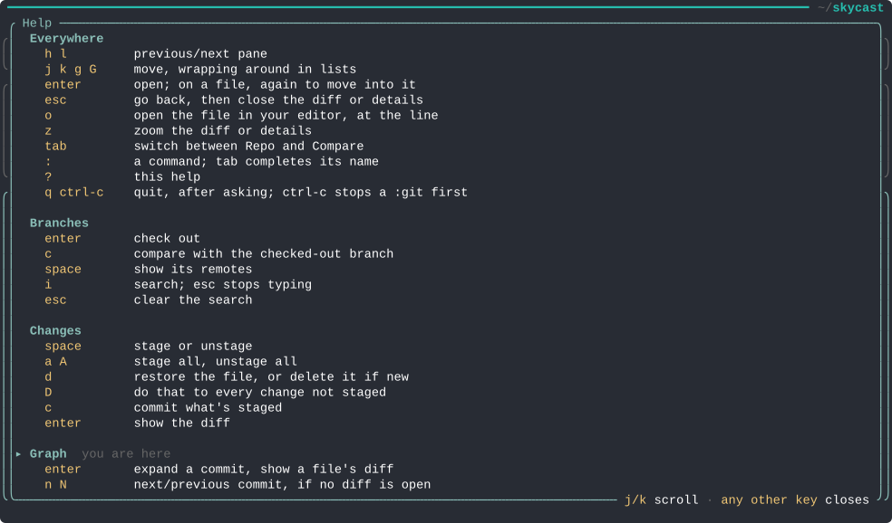

---

The screenshots are made from gclic itself, by `docs/screenshots.py`, on a demo repo it builds.

## License

gclic is under the [MIT License](LICENSE). Its colours are those of VS Code's Dark Modern theme, from [VS Code](https://github.com/microsoft/vscode), Copyright (c) Microsoft Corporation, also under the MIT License.
